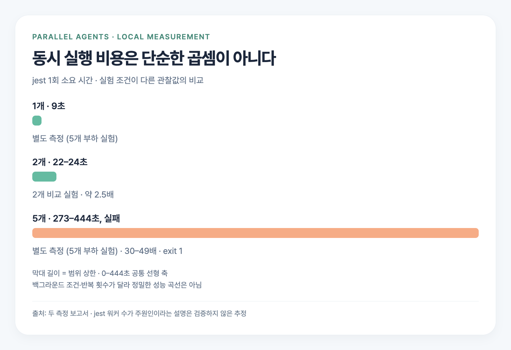
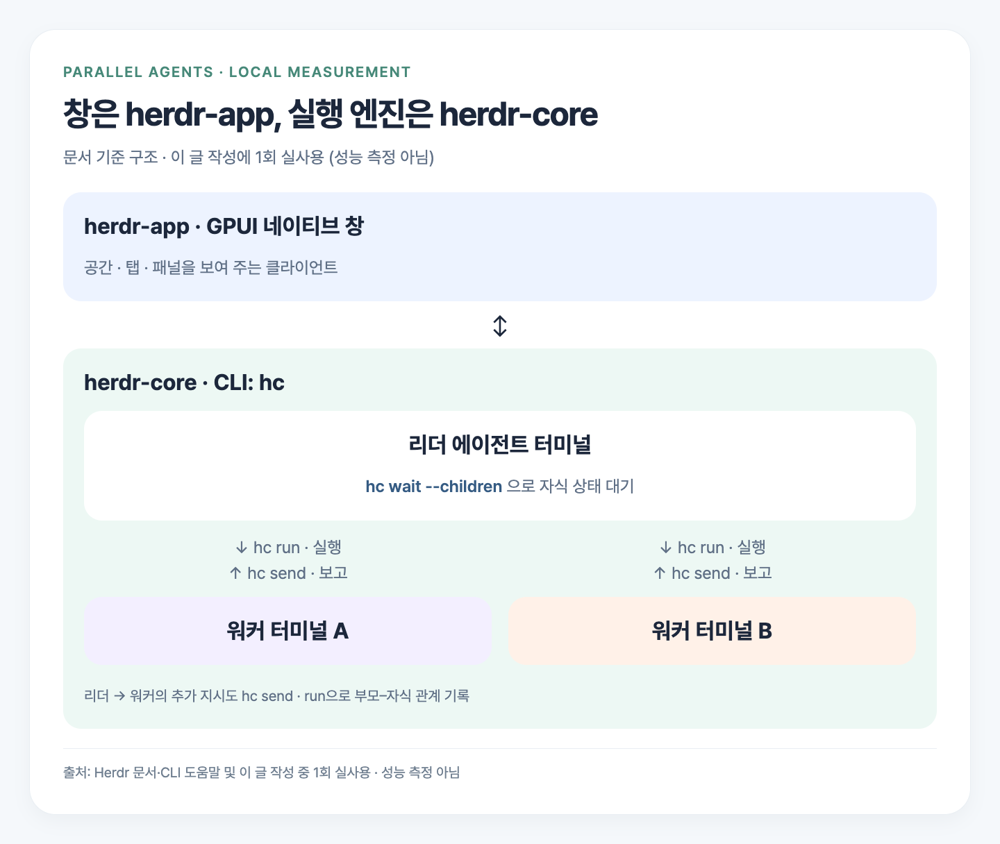
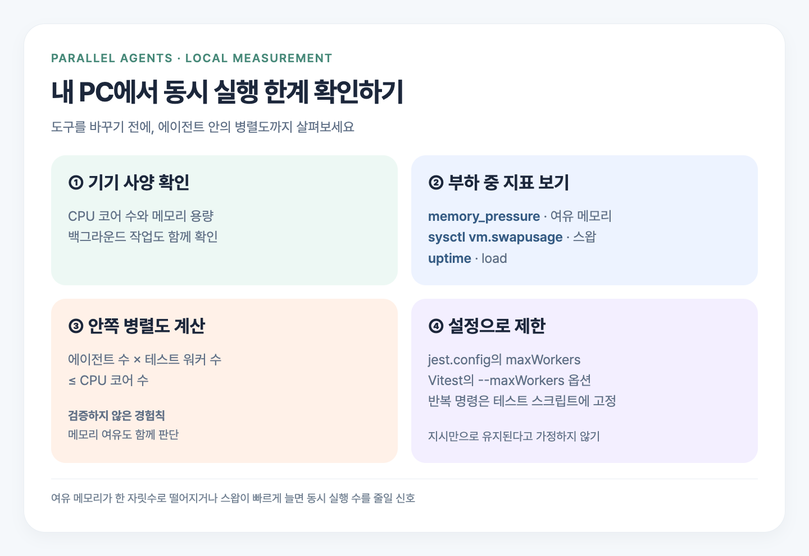

> AI 에이전트 5개에게 일을 나눠 주면 더 빨리 끝날 줄 알았어요. 그런데 테스트가 겹치자 PC가 사실상 멈췄습니다. 쓰고 있던 Orca가 무거운 걸까 싶어 Herdr로 옮기면서 직접 측정해 봤어요.
>
> 결과는 두 가지였습니다. **Herdr는 앱 자체가 가벼웠지만, 작업이 쓰는 자원은 그대로였어요.** 이번 글에서는 두 도구를 비교한 수치와, 내 PC에서 병렬 작업을 몇 개까지 돌릴지 판단할 때 볼 지표를 정리합니다.

## Orca와 Herdr는 무엇인가

둘 다 터미널과 코딩 에이전트를 다루는 도구입니다. Orca는 CLI에서 `worktree`, `agent launch`, `terminal` 명령을 제공해요. 작업 공간을 나누고 에이전트를 띄울 수 있습니다. 앱 번들에는 Electron Framework가 들어 있습니다.

Herdr는 **창과 실행 엔진이 분리**되어 있어요. `herdr-app`은 공간·탭·패널을 보여 주는 창이고, `herdr-core`는 터미널과 에이전트를 실행하는 엔진입니다. CLI인 `hc`로 이 엔진을 다룹니다. UI는 GPUI 기반 네이티브 UI예요.

이 설명은 측정 당시 설치된 앱의 문서와 CLI 도움말을 기준으로 합니다. UI 구현 방식만으로 작업 성능까지 판단하지 않고, 실제 부하를 따로 확인했습니다.

## 어떻게 측정했나

측정 기기는 **12코어, 메모리 18GB**인 Mac입니다. 대상은 **회사 Next.js 프론트엔드 저장소(TS 파일 약 960개, jest 테스트 1833개)**였어요.

터미널마다 `tsc --noEmit` → `eslint src` → `jest --ci --silent`를 실행했습니다. 두 실험의 조건은 구분해서 봐야 합니다.

| 실험 | 실행 조건 | 목적 |
| --- | --- | --- |
| 5개 부하 실험 | Herdr 터미널 5개, 각 작업 세트를 3회 반복 | PC가 버벅이는 현상 재현 |
| 2개 비교 실험 | Herdr와 Orca에서 각각 2개 동시, 각 1회 | 같은 작업에서 앱 몫 비교 |

5초마다 프로세스를 앱·작업·에이전트·에이전트 하위 프로세스로 분류해 메모리와 CPU를 기록했습니다. 부하가 커지면 수집 자체가 늦어져 실제 샘플 간격은 불규칙해졌어요. 아래 시계열은 샘플 번호 대신 실제 기록 시각을 사용했습니다.

2개 비교에서는 단계마다 **직전 30초의 기준값과 차이**를 계산했습니다. 양쪽 모두 첫 터미널을 화면에 띄워 두고 측정했어요. 5개 부하 실험도 부하를 걸기 전 30초 평균을 기준으로 삼았습니다.

## 5개 돌리면 PC가 멈춘다 — 에이전트 없이도


먼저 에이전트를 거치지 않고 **Herdr 터미널 5개에서 명령만 동시에 실행**했습니다. 이것만으로도 같은 현상이 재현됐어요.

| 지표 | 시작 전 | 부하 중 |
| --- | --- | --- |
| 여유 메모리 | 47% | **최저 2%** |
| 스왑 | 5.4GB | **최대 13.2GB** |
| load | 7 | **최대 114** |
| 작업 세트 완료 시간 | 혼자 50초 | **1076초, 약 18분** |

47%·5.4GB·7은 시작 전 평균이고, 2%·13.2GB·114는 부하 구간의 최저·최대값입니다. 모두 마지막 시점의 값이라는 뜻은 아니에요.

혼자 돌리면 50초였던 작업 세트가 약 18분까지 늘었습니다. jest 1회는 **273–444초**가 걸렸고 모두 실패(exit 1)했어요. 에이전트를 실행하지 않아도 재현됐으니, 에이전트 앱만 바꿔 해결할 문제라고 보기는 어려웠습니다.

## 앱 자체는 Herdr가 가볍다


앱 몫만 떼어 보면 차이는 분명했습니다. 2개 동시 비교에서 앱 본체 메모리는 **Herdr 68–111MB**, **Orca 630–673MB**였어요. 명령 단계와 에이전트 단계에서 나온 범위로, 약 **560MB** 차이입니다.

앱 CPU의 직전 기준값 대비 증가폭은 보고서의 요약 표기로 **Herdr +0–3%p**, **Orca +15–21%p**였습니다. 시스템 전체 CPU 사용률과는 구분해서 읽어야 해요.

다만 언제나 560MB를 아끼는 것은 아닙니다. 앞선 대기 측정에서는 **Orca 391MB 대 Herdr 165MB**, 차이가 **약 200MB**였어요. 앱 상태가 달랐으므로 두 측정값을 함께 보는 게 맞습니다.

## 하지만 작업 비용은 같다


2개 동시 실행에서 작업 완료 시간은 양쪽 모두 **35초**였습니다. 명령별 시간도 같은 범위였어요.

| 명령 | 두 도구의 측정 범위 |
| --- | --- |
| tsc | 4–5초 |
| eslint | 6초 |
| jest | 22–24초 |

정확히는 Herdr의 두 터미널이 각각 5·6·24초, Orca가 4·6·23초와 4·6·22초였습니다. 위 표는 이를 공통 범위로 묶은 요약이고, 모두 exit 0이었어요. 전체 35초는 측정 단계의 길이이므로 각 범위의 끝값을 더한 결과와 같을 필요는 없습니다.

작업 프로세스의 메모리는 평균 약 **2GB**, 최대 **3.5–3.7GB**였습니다. 앱에서 아낀 메모리도 의미는 있지만, 테스트와 린트가 쓰는 자원은 훨씬 컸어요.

## 곱하기로 추정할 수 없다



1개에서 2개, 5개로 늘렸을 때 시간은 단순히 곱하기로 늘지 않았습니다. **9초 → 22–24초 → 273–444초와 실패**였어요. 스왑이 급증하는 상황에서 실행 시간이 비선형으로 늘어난 겁니다.

다만 1개와 5개는 별도의 5개 부하 실험에서 가져온 값입니다. 2개 비교와 백그라운드 조건·반복 횟수가 달라, 정밀한 성능 곡선으로 읽을 수는 없어요. 적어도 이 관찰에서는 2개 결과를 곱해서 5개의 비용을 예상할 수 없었습니다.

원인 후보는 **jest의 병렬 워커가 겹치는 것**입니다. 측정 보고서에 따르면 기본 워커 수는 코어 수−1, 이 기기에서는 11개입니다. 5개 작업이면 55개 워커가 경쟁할 수 있어요. 하지만 **이것이 주원인이라는 설명은 추정**입니다. 워커 수를 바꿔 비교하는 실험은 하지 않았습니다.

## 그래서 Herdr로 옮긴 이유



이전의 이득은 두 가지로 정리했습니다. 첫째는 **앱 자체가 가벼워진 것**입니다. 대기 상태에서 약 200MB, 2개 동시 측정에서 약 560MB의 차이가 있었습니다.

둘째는 **문서 기준의 사용성**입니다. `hc run`으로 리더가 워커 터미널을 만들면 부모·자식 관계가 기록됩니다. 리더는 `hc send`로 추가 지시를 보내고, 워커도 `hc send`로 보고할 수 있어요. 리더는 `hc wait --children`으로 자식들의 상태를 기다릴 수 있습니다. 창과 실행 엔진이 분리된 가벼운 UI도 선택 이유였어요.

**성능 측정은 아니지만, 이 글을 만드는 과정에서 리더↔워커 왕복을 실제로 한 번 써 봤습니다.**

리더 에이전트가 `hc run`으로 작업용 git 워크트리에서 워커를 띄웠어요. 첫 실행은 zsh가 공간·탭 라벨 옵션을 담은 변수를 공백으로 나누지 않아 실패했고, `${=L}`로 인자를 나눠 넘겨 해결했습니다. 다음 실행에서는 폴더 신뢰 확인 창 때문에 첫 과제가 전달되지 않아, 사용자 확인을 받아 수락한 뒤 `hc send`로 과제를 다시 보냈어요. 리더가 `hc wait --children any`로 기다리는 동안 워커는 글과 이미지 7장을 만들고 빌드까지 마쳤습니다. 다만 검증 명령이 이미지 6개에 공통 CSS 선택자까지 더해 9개로 세자, 워커는 승인된 플랜을 임의로 바꾸지 않고 멈춘 뒤 `hc send`로 원인을 보고했어요. 리더는 빌드 결과를 직접 다시 세어 진단을 확인하고, 사용자 승인을 받아 같은 워커에 수정 지시를 보냈습니다.

이것은 **1회 사용 경험**이며, 작업 시간이나 버벅임이 개선됐다는 성능 측정 결과는 아닙니다.

실무적으로 하나 걸린 점도 있어요. 측정 당시 `hc run`으로 직접 띄운 명령에는 nvm PATH가 없어 `node`를 찾지 못했습니다. Herdr UI에서 여는 탭은 로그인 셸이라 문제가 없었어요. 직접 실행하는 명령에도 Node 실행 경로가 잡혀 있는지 먼저 확인할 필요가 있습니다.

## 내 PC에서 몇 개까지 돌릴 수 있을까



이번 기준점은 **12코어·18GB에서 2개는 jest가 약 2.5배 느려졌고, 5개는 PC가 사실상 멈췄다**는 것입니다. **5개 초과는 측정하지 않았습니다.** 다만 5개에서 이미 여유 메모리가 2%였으므로 그 이상에서 나아지기는 어려워 보여요.

이 숫자를 모든 PC의 한계로 쓰기보다는, 내 환경에서 아래 순서로 확인해 보세요.

**1. 기기 사양부터 확인하기**

CPU 코어 수와 메모리 용량을 확인합니다. 에이전트 개수뿐 아니라 각 에이전트가 안에서 얼마나 많은 프로세스를 띄우는지도 함께 봐야 해요.

**2. 작업을 돌리는 동안 세 지표 보기**

macOS에서는 다음 명령으로 여유 메모리, 스왑, load를 확인할 수 있습니다.

```sh
memory_pressure
sysctl vm.swapusage
uptime
```

`memory_pressure`의 여유 메모리 비율이 한 자릿수로 떨어지거나, `sysctl vm.swapusage`의 스왑 사용량이 빠르게 늘면 동시 실행 수를 줄일 신호로 보세요. `uptime`의 load도 함께 살펴봅니다. 하나의 수치만으로 원인을 확정하기보다는 작업 전후의 변화를 보는 것이 목적입니다.

**3. 에이전트 안의 병렬도까지 계산하기**

출발점으로 삼을 만한 **검증하지 않은 경험칙**은 다음과 같습니다.

> 동시 에이전트 수 × 테스트 워커 수 ≤ CPU 코어 수

이번 관찰에서는 2개 × 기본 워커 11개 = **22개**로 12코어를 넘겼을 때 jest가 약 2.5배 느려졌고, 5개 × 11개 = **55개**에서는 멈췄습니다. 이 두 점을 바탕으로 병렬도를 보수적으로 시작하자는 뜻이지, 위 식 안쪽이면 안전하다고 검증한 것은 아닙니다. 메모리와 백그라운드 작업도 함께 봐야 해요.

**4. 워커 제한은 설정으로 강제하기**

에이전트에게 지시만 했더니 **4개 중 1개**만 워커 제한을 지켰습니다. 반복해서 지켜야 하는 규칙이라면 저장소 설정에 넣는 편이 낫습니다. 예를 들어 기존 `jest.config`에 다음 값을 넣을 수 있어요.

```js
module.exports = {
  maxWorkers: 2,
};
```

기존 설정을 지우지 말고 `maxWorkers` 항목만 합쳐 주세요. Vitest를 실행한다면 `vitest run --maxWorkers=2`처럼 워커 상한을 지정할 수 있습니다. 반복 실행할 명령은 프로젝트의 테스트 스크립트에도 고정해 두세요.

**`maxWorkers=2`로 제한한 상태의 성능은 측정하지 않았습니다.** 따라서 2가 최적값이라는 뜻도 아니에요. 내 PC에서 여유 메모리·스왑·완료 시간을 보며 조정할 출발점입니다. 이 과정은 Orca나 Herdr 중 어느 도구를 쓰든 적용할 수 있습니다.

## 측정의 한계

- **2개 비교는 반복 없이 각 1회만 측정**했습니다. 5개 부하 실험의 작업 세트 3회 반복과는 구분해야 합니다.
- **백그라운드 앱의 영향이 컸습니다.** Chrome, 다른 프로젝트의 Docker 컨테이너, 다른 Claude 세션이 실행 중이었어요. 같은 작업에서도 스왑 증가가 **1.2GB와 5.6GB**로 달랐습니다.
- **에이전트마다 행동이 달랐습니다.** 워커 제한을 지킨 에이전트도, 기본값으로 실행한 에이전트도 있어 에이전트 단계의 시간 차이는 결론에 쓰지 않았어요.
- **앱 메모리도 측정마다 달랐습니다.** Orca는 약 390MB(대기 평균 391MB)와 630–673MB, Herdr는 165MB와 68–111MB였습니다. 앱의 열린 화면과 상태가 다른 측정입니다.
- **5개 부하는 Herdr에서만 측정했습니다.** Orca 단계는 PC가 버벅여 시작 직후 중단했습니다. 5개 조건에서 두 도구를 비교한 결과는 없습니다.
- **jest 워커 수가 주원인이라는 설명은 검증하지 않은 추정**입니다. 워커 수만 바꾸는 비교 실험은 하지 않았습니다.

## 마치며

Herdr로 옮기며 앱 몫의 자원을 줄일 수 있다는 점은 확인했습니다. 하지만 같은 tsc·eslint·jest 작업의 비용은 그대로였어요. **도구를 바꾸기 전에 병렬도부터 보자**는 것이 이번 측정에서 얻은 결론입니다.

내 PC에서 몇 개가 적당한지 궁금하다면 위의 **「내 PC에서 몇 개까지 돌릴 수 있을까」**부터 따라가 보세요. 코어 수와 메모리를 확인하고, 부하 중 여유 메모리·스왑·load를 보면서 에이전트 수와 테스트 워커 수를 함께 조정하는 방식입니다.

측정 근거는 2026-11-11에 직접 수집한 로컬 측정 보고서와 원본 데이터(CSV, 명령 로그)입니다. 제품 설명은 설치된 Herdr 문서와 `hc --skill`, `orca --help`, Orca 앱 번들을 확인했습니다.
