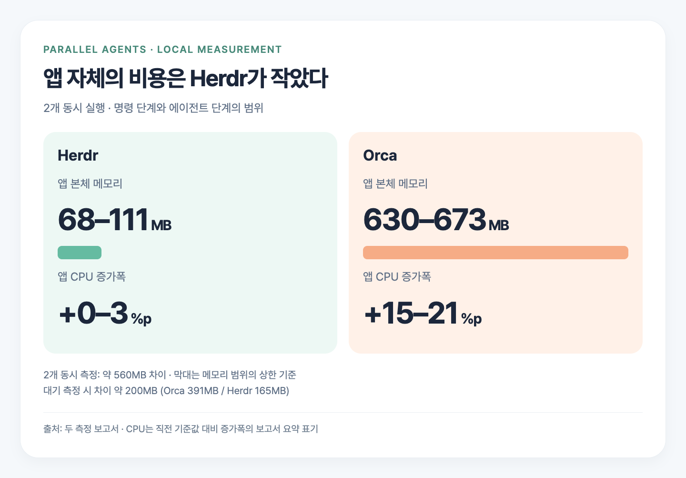
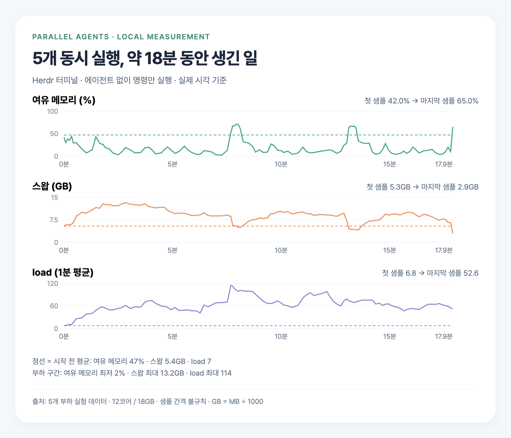
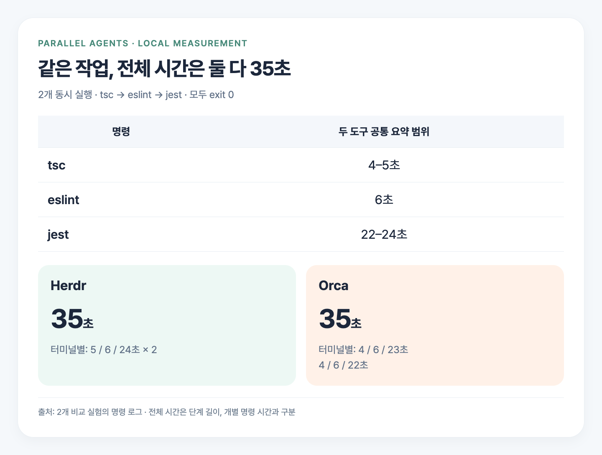

> 혹시 병렬로 에이전트를 여러 개 돌리다가 컴퓨터가 멈춘 적 있으신가요? 저는 Orca에서 에이전트를 5개 정도 돌리면 PC가 멈췄거든요. Orca가 메모리를 너무 많이 쓰는 것 같아서 Herdr로 옮기면서 직접 재 봤어요.
>
> **같은 작업에서 앱 메모리는 Orca 630–673MB, Herdr 68–111MB였습니다.** 이번 글에서는 두 도구의 메모리 차이와 병렬 작업 중 PC가 멈췄던 실험, 그리고 제가 Herdr로 옮긴 이유를 공유해보려 합니다.

## Orca와 Herdr는 어떤 도구인가

둘 다 터미널과 코딩 에이전트를 다루는 도구예요. Orca는 CLI의 `worktree`, `agent launch`, `terminal` 명령으로 작업 공간을 나누고 에이전트를 띄워요. 앱 번들에는 Electron Framework가 들어 있고요. Herdr는 공간·탭·패널을 보여 주는 창인 `herdr-app`과 터미널과 에이전트를 실행하는 엔진인 `herdr-core`가 분리돼 있어요. UI는 GPUI 기반 네이티브 UI예요.

직접 재 본 환경은 12코어, 메모리 18GB인 Mac이에요. 회사 Next.js 프론트엔드 저장소를 사용했고, TS 파일 약 960개와 jest 테스트 1833개가 들어 있어요. 터미널마다 `tsc --noEmit` → `eslint src` → `jest --ci --silent`를 순서대로 돌렸습니다. 실험은 두 가지로 나눴어요. 두 도구에서 각각 2개를 동시에 돌려 각 1회 비교했어요. 별도로 Herdr 터미널 5개에서는 에이전트 없이 명령만 돌리고, 각 작업 세트를 3회 반복했고요.

## Orca는 메모리를 얼마나 쓰고 있었나

가장 먼저 보고 싶었던 건 앱 자체가 쓰는 메모리였어요. 테스트와 린트가 차지하는 메모리까지 합치면, 도구를 바꿨을 때 어떤 차이가 생기는지 구분하기 어려우니까요.

2개를 동시에 실행한 비교에서 Orca 앱 본체는 630–673MB, Herdr는 68–111MB를 썼습니다. 명령 단계와 에이전트 단계에서 나온 범위예요. **앱 메모리만 약 560MB 차이**가 났어요. Orca가 메모리를 많이 쓰는 것 같다는 느낌이 있었는데, 같은 작업을 놓고 재 보니 실제로 더 많이 쓰고 있더라고요.

CPU도 차이가 있더라고요. 직전 기준값에서 앱 CPU가 얼마나 늘었는지 봤더니, Orca는 +15–21%p, Herdr는 +0–3%p였어요. 시스템 전체가 아닌 앱 몫의 증가폭을 비교한 값이에요. 같은 작업을 실행하는 동안 앱 자체가 쓰는 메모리와 CPU 증가폭 모두 Herdr 쪽이 작았던 거죠.

아무 작업도 하지 않고 기다릴 때는 어떨까요?

별도로 잰 대기 상태에서는 Orca가 391MB, Herdr가 165MB였어요. 이때 차이는 약 200MB였습니다. 앞의 2개 동시 비교와는 앱 상태가 달랐던 별도 측정이에요. 두 측정에서 모두 Orca가 메모리를 더 많이 썼어요.

제가 Herdr로 옮긴 이유도 이 부분이에요. 병렬로 작업하다 PC가 멈추는 상황이었으니, 앱 자체가 쓰는 메모리 차이가 눈에 들어올 수밖에 없었거든요. 작업을 실행하는 도구가 더 가볍다는 것만으로도 제겐 선택할 이유가 충분했어요.

## 병렬로 5개를 돌리자 PC가 멈췄다

저는 Orca에서 에이전트를 5개쯤 돌리면 PC가 멈췄어요. 병렬로 일을 맡겼는데 컴퓨터가 멈춰버리면 작업을 이어가기 어렵잖아요. 그때처럼 부하가 몰리면 메모리와 작업 시간은 어떤 상태가 되는지 직접 재 봤습니다. 이 부하 실험은 Herdr 터미널 5개에서 에이전트 없이 명령만 돌린 결과예요.

| 지표 | 시작 전 | 부하 중 |
| --- | --- | --- |
| 여유 메모리 | 47% | 최저 2% |
| 스왑 | 5.4GB | 최대 13.2GB |
| load | 7 | 최대 114 |
| 작업 세트 완료 시간 | 혼자 50초 | 1076초, 약 18분 |

여유 메모리·스왑·load의 시작 전 값은 평균이고, 부하 중 값은 해당 구간의 최저·최대예요. 여유 메모리는 47%에서 최저 2%까지 내려갔고, 스왑은 5.4GB에서 최대 13.2GB까지 늘었어요. 작업 세트는 혼자 돌리면 50초였는데, 이 실험에서는 1076초, 약 18분까지 걸렸고요. jest 1회도 273–444초가 걸렸고 모두 실패해 `exit 1`로 끝났어요.

Orca에서도 5개를 돌리려 했지만 PC가 버벅여 시작 직후 중단했어요. 그래서 5개 조건의 Orca 수치와 두 도구의 비교 결과는 없어요.

## 작업 시간은 두 도구 모두 35초였다

그럼 Herdr에서는 실제 작업도 빨리 끝났을까요? **2개 동시 비교의 작업 완료 시간은 두 도구 모두 35초**였어요.

2개 동시 비교에서 명령별로도 `tsc --noEmit`은 4–5초, `eslint src`는 6초, `jest --ci --silent`는 22–24초 범위였어요. 모두 `exit 0`으로 끝났고요. 같은 작업을 같은 시간에 마치면서 앱 메모리는 Herdr가 덜 쓴 거예요.

작업 프로세스의 메모리는 두 도구 모두 평균 약 2GB, 최대 3.5–3.7GB였어요. 테스트와 린트가 쓰는 자원은 앱 자체가 쓰는 몫보다 훨씬 컸습니다.

## 그래서 Herdr로 옮겼다

제가 옮긴 이유는 앱 메모리를 줄일 수 있어서예요. 작업 시간은 같았지만 Orca가 메모리를 더 많이 썼거든요. 병렬로 돌리면 PC가 멈추던 상황이라 Herdr가 더 가볍고 빠르게 느껴졌어요. **병렬로 돌리는 작업이 많은 분께는 Herdr를 추천합니다.**

GUI는 Orca가 훨씬 편해요. 워크트리를 쉽게 쓰게 해 주는 부분이 그렇거든요. 같은 일이 Herdr에서도 가능은 해요. 저는 그 차이를 두고 앱이 덜 쓰는 메모리 쪽을 선택했어요.

Herdr의 실행 엔진은 CLI인 `hc`로 다룰 수 있어요. 문서 기준으로 `hc run`으로 리더가 워커 터미널을 만들면 부모·자식 관계가 기록되고, `hc send`로 추가 지시를 보내거나 워커가 보고할 수 있습니다. 리더는 `hc wait --children`으로 자식들의 상태를 기다릴 수 있고요.

측정 당시 `hc run`으로 직접 띄운 명령은 nvm PATH가 없어 `node`를 찾지 못했어요. Herdr UI에서 여는 탭은 로그인 셸이라 괜찮았고요. nvm을 쓴다면 `hc run`으로 실행할 때 경로를 확인해주세요.

Herdr로 옮겨도 5개는 무리였어요. 앞의 부하 실험에서는 PC가 사실상 멈췄거든요. 이 기기에서 jest의 기본 워커 수는 11개라, 작업 5개가 겹치면 55개 워커가 경쟁할 수 있어요. 이 워커들이 경쟁하는 게 주원인이라고 추정해요. 워커 수를 바꿔 비교하는 실험은 하지 않았습니다. 앱에서 메모리를 아끼는 것과 동시에 돌리는 테스트의 부하를 줄이는 것은 함께 살펴봐야 해요.

직접 확인할 때는 macOS에서 `memory_pressure`, `sysctl vm.swapusage`, `uptime`으로 여유 메모리·스왑·load를 보면 돼요. 여유 메모리가 한 자릿수로 떨어지거나 스왑이 빠르게 늘면 동시 실행 수를 줄일 신호예요. 워커 제한은 에이전트에게 지시만 했더니 4개 중 1개만 지켜서, `jest.config`에 `maxWorkers: 2`처럼 설정으로 넣는 편이 낫겠더라고요.

## 측정의 한계

다만 2개 동시 비교는 반복 없이 각 1회만 잰 결과입니다. 백그라운드에는 Chrome, 다른 프로젝트의 Docker 컨테이너, 다른 Claude 세션도 실행 중이었어요. 그 영향이 커서 같은 작업에서도 스왑 증가가 1.2GB와 5.6GB로 달랐습니다. 이번 수치는 제 환경에서 도구를 선택할 근거로 봐주시면 좋겠어요. 팁으로 적은 `maxWorkers: 2` 설정의 성능은 측정하지 않았고요.

## 마치며

Orca에서 에이전트를 5개쯤 병렬로 돌리면 PC가 멈췄고, 직접 재 보니 앱 메모리도 Orca가 더 많이 써서 Herdr로 옮겼습니다. **같은 작업 시간에 앱 메모리를 덜 쓰는 것**, 이게 제가 Herdr를 추천하는 이유예요. 병렬 작업이 많아 앱이 차지하는 메모리를 줄이고 싶은 분이라면 Herdr를 한번 써보세요.

긴 글 읽어주셔서 감사합니다! 🙏

 

**궁금하신 점이 있다면 아래 `댓글`로 남겨주세요!👇**
