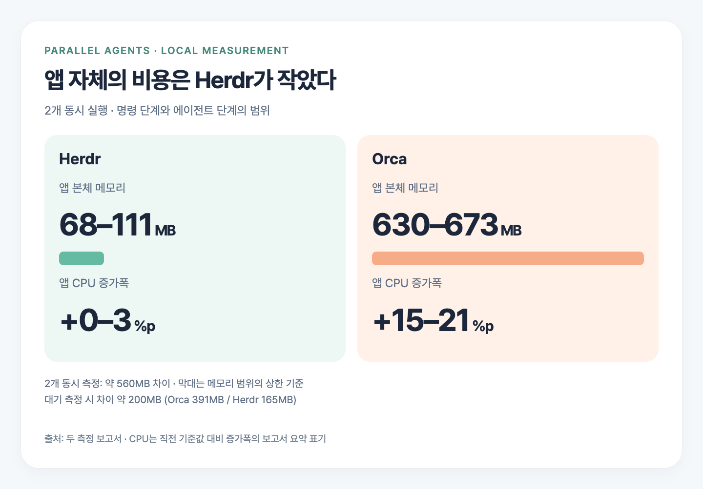
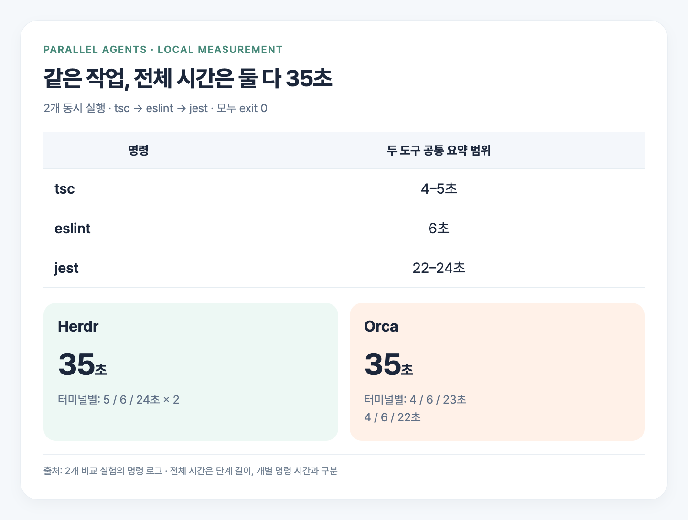

> 에이전트 여러 개를 병렬로 돌리다가 컴퓨터가 멈춘 적 있으신가요? 저는 Orca에서 에이전트를 5개 정도 돌리면 PC가 멈췄습니다. Orca가 메모리를 너무 많이 쓰는 것 같아 Herdr로 옮기면서 두 도구를 같은 작업으로 재 봤습니다.
>
> **같은 작업에서 앱 메모리는 Orca 630–673MB, Herdr 68–111MB였습니다.** 이 글에서는 같은 작업을 병렬로 돌릴 때 두 도구가 쓰는 메모리 차이와 Herdr로 옮긴 이유를 정리합니다.

## Orca와 Herdr는 같은 일을 다른 구조로 합니다

Orca와 Herdr는 둘 다 터미널과 코딩 에이전트를 다루는 도구입니다. Orca는 CLI의 `worktree`, `agent launch`, `terminal` 명령으로 작업 공간을 나누고 에이전트를 띄웁니다. 앱 번들에는 Electron Framework가 들어 있습니다.

Herdr는 구조가 다릅니다. 공간·탭·패널을 보여 주는 창인 `herdr-app`과, 터미널과 에이전트를 실행하는 엔진인 `herdr-core`가 분리돼 있습니다. UI는 [GPUI](https://gpui.rs/)(Zed 팀이 만든 Rust용 GPU 가속 UI 프레임워크) 기반입니다.

측정 환경은 12코어, 메모리 18GB인 Mac입니다. 두 도구 모두 같은 저장소에서, 터미널마다 `tsc --noEmit` → `eslint src` → `jest --ci --silent`를 순서대로 돌렸습니다.

두 도구에서 같은 작업을 각각 2개씩 동시에 돌려 각 1회 비교했습니다. 아무 작업도 하지 않는 대기 상태의 메모리는 따로 쟀습니다.

그럼 두 도구는 앱 자체로 메모리를 얼마나 쓸까요?

## 같은 작업에서 Orca 앱이 약 560MB를 더 썼습니다

같은 작업에서 앱 자체가 쓰는 메모리는 Orca가 훨씬 많았습니다. 앱 몫만 따로 본 이유는, 테스트와 린트가 차지하는 메모리까지 합치면 도구를 바꿨을 때 생기는 차이를 구분하기 어렵기 때문입니다.

2개를 동시에 실행한 비교에서 Orca 앱 본체는 630–673MB, Herdr는 68–111MB를 썼습니다. 명령 단계와 에이전트 단계에서 나온 범위입니다. **앱 메모리만 약 560MB 차이가 난 것이죠.** Orca가 메모리를 많이 쓴다는 느낌이 있었는데, 같은 작업을 놓고 재 보니 실제로 더 많이 쓰고 있었습니다.

CPU 증가폭도 달랐는데요. 직전 기준값에서 앱 CPU가 얼마나 늘었는지 보니 Orca는 +15–21%p(퍼센트포인트), Herdr는 +0–3%p였습니다. 시스템 전체가 아니라 앱 몫의 증가폭만 비교한 값입니다. 같은 작업을 하는 동안 앱의 메모리와 CPU 증가폭 모두 Herdr 쪽이 작았습니다.

아무 작업도 하지 않고 기다릴 때도 차이는 있었습니다. 별도로 잰 대기 상태에서는 Orca가 391MB, Herdr가 165MB로, 약 200MB 차이가 났습니다. 다만 앞의 2개 동시 비교와는 앱 상태가 다른 별도 측정입니다. 두 측정 모두에서 Orca가 메모리를 더 많이 썼다는 점은 같습니다.

Orca가 메모리를 많이 쓴다는 보고는 저만 한 것이 아닙니다. Orca 저장소에는 여러 에이전트를 동시에 돌리면 메모리가 계속 늘어나 UI가 멈추고 결국 앱이 종료된다는 [이슈](https://github.com/stablyai/orca/issues/29899)가 열려 있습니다.

그렇다면 메모리를 더 쓰는 만큼 작업은 더 빨리 끝났을까요?

## 작업 시간은 두 도구 모두 35초였습니다

작업 속도는 같았습니다. **2개 동시 비교의 작업 완료 시간은 두 도구 모두 35초였습니다.**

명령별로 봐도 `tsc --noEmit`은 4–5초, `eslint src`는 6초, `jest --ci --silent`는 22–24초 범위였습니다. 모두 `exit 0`으로 끝났고요. 같은 작업을 같은 시간에 마치면서 앱 메모리는 Herdr가 덜 쓴 것입니다.

이 비교에서 작업 프로세스의 메모리는 두 도구 모두 평균 약 2GB, 최대 3.5–3.7GB 수준이었습니다. 작업 시간이 같고 작업 프로세스의 메모리도 비슷했으니, 앱 메모리와 앱 CPU 증가폭이 작은 Herdr 쪽이 더 가벼웠습니다.

## 그래서 Herdr로 옮겼습니다

제가 옮긴 이유는 이 앱 메모리를 줄일 수 있어서입니다. 작업 시간은 같았지만 Orca가 메모리를 더 많이 썼습니다. 병렬로 작업하다 PC가 멈추던 상황이라, 앱 자체가 쓰는 메모리 차이가 눈에 들어올 수밖에 없었습니다.

작업을 실행하는 도구가 더 가볍다는 것만으로도 저에게는 선택할 이유가 충분했습니다. 병렬로 돌릴 때 Herdr가 더 가볍고 빠르게 느껴지기도 했습니다. **병렬로 돌리는 작업이 많은 분께는 Herdr를 추천합니다.**

다만 GUI는 Orca가 훨씬 편합니다. 특히 워크트리를 쉽게 쓰게 해 주는 부분이 그렇습니다. 같은 일을 Herdr에서도 할 수는 있습니다. 저는 그 차이를 두고 앱이 덜 쓰는 메모리 쪽을 골랐습니다.

Herdr의 실행 엔진은 CLI인 `hc`로 다룰 수 있습니다. 문서 기준으로, 리더가 `hc run`으로 워커 터미널을 만들면 부모·자식 관계가 기록되고 `hc send`로 추가 지시를 보내거나 워커가 보고할 수 있습니다. 리더는 `hc wait --children`으로 자식들의 상태를 기다릴 수 있고요.

옮긴 뒤에도 병렬로 돌릴 때 챙기는 것이 두 가지 있습니다.

## Herdr로 옮긴 뒤에도 메모리와 경로는 확인합니다

도구가 가벼워져도 여러 작업을 동시에 돌리면 메모리는 빠듯해질 수 있습니다. 병렬로 돌린다면 다음 두 가지를 먼저 확인해 보세요.

- 메모리 상태: macOS에서는 `memory_pressure`, `sysctl vm.swapusage`, `uptime`으로 여유 메모리·스왑·load(실행 중이거나 차례를 기다리는 프로세스 수의 평균)를 볼 수 있습니다. 여유 메모리가 한 자릿수로 떨어지거나 스왑이 빠르게 늘면 동시 실행 수를 줄일 신호입니다.
- nvm 경로: 측정 당시 `hc run`으로 직접 띄운 명령은 nvm PATH가 없어 `node`를 찾지 못했습니다. Herdr UI에서 여는 탭은 로그인 셸이라 문제가 없었습니다. nvm을 쓴다면 `hc run`으로 실행할 때 경로를 확인하세요.

다만 이 비교에는 측정 한계가 있습니다.

## 2개 동시 비교는 한 번씩 잰 결과입니다

2개 동시 비교는 반복 없이 각 1회만 잰 결과입니다. 측정하는 동안 백그라운드에서는 Chrome, 다른 프로젝트의 Docker 컨테이너, 다른 Claude 세션도 실행 중이었습니다. 그 영향이 커서 같은 작업에서도 스왑 증가가 1.2GB와 5.6GB로 달랐습니다.

5개를 동시에 돌리는 조건은 Orca에서 시작하자마자 PC가 버벅여 중단했기 때문에, 두 도구를 같은 조건으로 비교하지 못했습니다. 그래서 Herdr로 바꾸면 5개를 돌려도 멈추지 않는다고 말할 수는 없습니다. 이번 수치는 범용 벤치마크가 아니라, 제 환경에서 도구를 고른 근거로 봐 주세요.

## 마치며

Orca에서 에이전트를 5개쯤 병렬로 돌리면 PC가 멈췄고 직접 재 보니 같은 작업에서 앱 메모리도 Orca가 더 많이 썼습니다. **같은 작업 시간에 앱 메모리를 덜 쓴다는 것**, 이것이 제가 Herdr로 옮기고 추천하는 이유입니다.

병렬 작업이 많아 앱이 차지하는 메모리를 줄이고 싶다면 Herdr를 한번 써 보세요. 그리고 여러 개를 동시에 돌린다면, 여유 메모리와 스왑부터 확인해 보세요.
